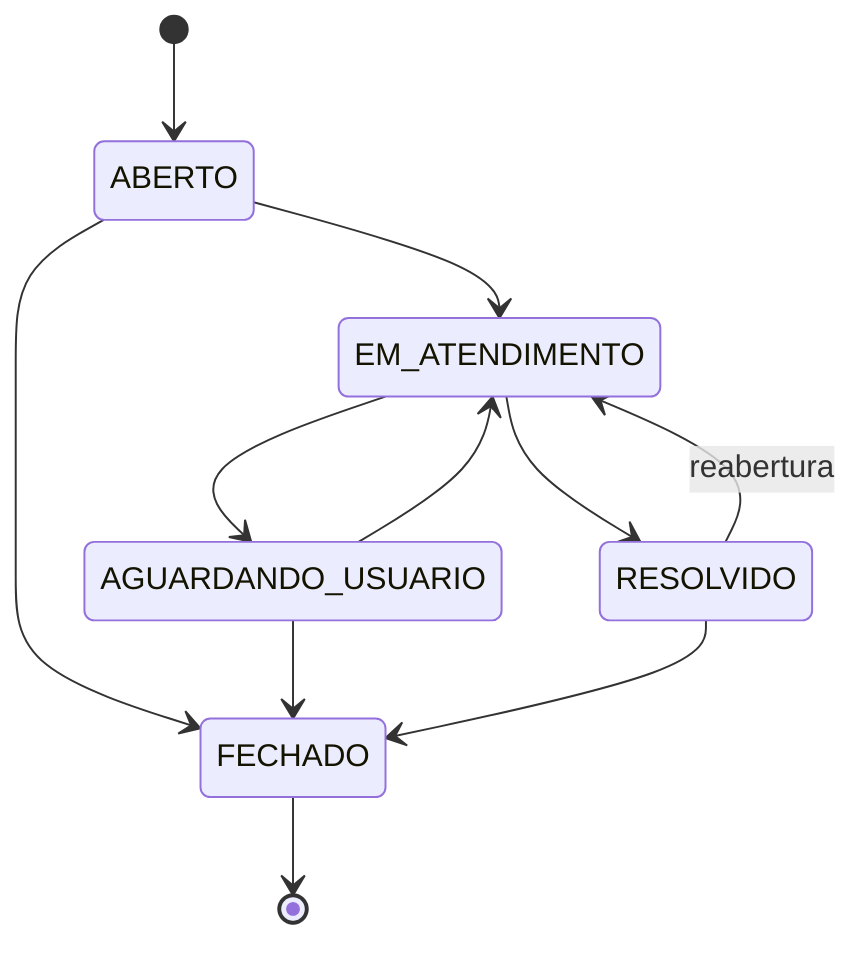

# helpdesk-api

[](https://github.com/guifqz/helpdesk-api/actions/workflows/ci.yml)


> REST API for an IT helpdesk: tickets, comments, JWT authentication, role-based access, priority-driven SLA and a validated status state machine.
> Built with Java 21, Spring Boot 3.3, Spring Security (OAuth2 resource server), JPA, Flyway, PostgreSQL/H2.

API REST de chamados de TI (helpdesk), pensada como um serviço pequeno mas completo: autenticação JWT, controle de acesso por papel, SLA calculado pela prioridade e fluxo de status protegido por uma máquina de estados.

O domínio vem da rotina real de um coordenador de TI: abrir chamado, triar, atribuir a um técnico, acompanhar o prazo e medir o tempo de resolução.

## Sumário

- [Funcionalidades](#funcionalidades)
- [Arquitetura](#arquitetura)
- [Regras de negócio](#regras-de-negócio)
- [Como executar](#como-executar)
- [Documentação interativa (Swagger)](#documentação-interativa-swagger)
- [Exemplos com curl](#exemplos-com-curl)
- [Endpoints](#endpoints)
- [Testes e CI](#testes-e-ci)
- [Decisões técnicas](#decisões-técnicas)
- [Licença](#licença)

## Funcionalidades

- Login com JWT (HS256) e três papéis: `SOLICITANTE`, `TECNICO` e `ADMIN`.
- CRUD de chamados com paginação, ordenação e filtros por status, prioridade e categoria.
- Mudança de status validada por máquina de estados (transição inválida retorna `422`).
- Prazo de SLA calculado a partir da prioridade e recalculado quando a prioridade muda.
- Atribuição de chamados a técnicos e comentários por chamado.
- Dashboard com contagem por status, chamados com SLA vencido e tempo médio de resolução.
- Erros padronizados com `ProblemDetail` (RFC 9457) e validação de entrada com mensagens por campo.
- Migrações versionadas com Flyway, documentação OpenAPI e endpoint de health via Actuator.

## Arquitetura

Aplicação em camadas, com as regras de negócio concentradas no domínio e sem lógica nos controllers.

```
dev.guifqz.helpdesk
├── config/       SecurityConfig (JWT HS256, rotas), OpenApiConfig, JwtProperties, Clock
├── domain/       Entidades JPA (Usuario, Chamado, Comentario), enums, FluxoStatus, PoliticaSla
├── repository/   Spring Data JPA (Specifications para filtros, projeções para o dashboard)
├── service/      Casos de uso transacionais e regras de acesso por papel
├── security/     TokenService (emissão do JWT) e UsuarioAutenticado (claims do token)
├── web/          Controllers REST
│   └── dto/      Records de entrada e saída
└── exception/    Exceções de domínio e GlobalExceptionHandler (ProblemDetail)
```

Fluxo de uma requisição: `JWT no header` → `Spring Security (resource server)` → `Controller` → `Service (@Transactional)` → `Domain/Repository` → `DTO (record)`.

Pontos de projeto:

- `FluxoStatus` e `PoliticaSla` são classes puras, sem Spring, e por isso testadas com testes unitários simples.
- A entidade `Chamado` protege seus próprios invariantes (`alterarStatus`, `atribuir`, `atualizarDados`); o serviço apenas orquestra.
- O tempo é injetado via `java.time.Clock`, o que mantém o cálculo de SLA determinístico.
- `spring.jpa.open-in-view=false`: o mapeamento para DTO acontece dentro da transação, sem `LazyInitializationException` e sem consulta escondida na camada web.
- A listagem usa `@EntityGraph` para carregar solicitante e técnico na mesma consulta (sem N+1).

## Regras de negócio

### Máquina de estados



Qualquer transição fora do diagrama (inclusive para o mesmo status) retorna `422 Unprocessable Entity`. `FECHADO` é terminal. Ao iniciar o atendimento de um chamado sem técnico, quem alterou o status assume o chamado.

### SLA por prioridade

| Prioridade | Prazo de resolução |
|---|---|
| `CRITICA` | 4 horas |
| `ALTA` | 8 horas |
| `MEDIA` | 24 horas |
| `BAIXA` | 72 horas |

O `prazoSla` é `criadoEm + prazo da prioridade`. Um chamado está com SLA vencido (`slaVencido: true`) quando o prazo passou e ele ainda não foi `RESOLVIDO` nem `FECHADO`.

### Permissões

| Ação | SOLICITANTE | TECNICO | ADMIN |
|---|:---:|:---:|:---:|
| Abrir chamado | sim | sim | sim |
| Listar / ver chamados | apenas os próprios | todos | todos |
| Atualizar dados do chamado | apenas os próprios | todos | todos |
| Comentar | apenas nos próprios | todos | todos |
| Alterar status | não | sim | sim |
| Atribuir técnico | não | sim | sim |
| Dashboard | não | sim | sim |
| Remover chamado | não | não | sim |

Sem token ou com token inválido a resposta é `401`; com token válido e papel insuficiente, `403`. Chamado fechado não aceita edição, atribuição nem novos comentários.

## Como executar

Pré-requisitos para rodar localmente: JDK 21 e Maven 3.9+. O projeto não usa Maven Wrapper; o CI usa `setup-java` com o `mvn` instalado.

### Com Maven (H2 em memória)

```bash
mvn spring-boot:run
```

A API sobe em `http://localhost:8080` com banco H2 em memória. As migrações Flyway criam o schema e os usuários de demonstração a cada inicialização.

### Com Docker (PostgreSQL)

```bash
docker compose up --build
```

Sobe o PostgreSQL 16 e a API com o perfil `prod`. Defina `JWT_SECRET` (mínimo 32 caracteres) para não usar o valor padrão do compose:

```bash
JWT_SECRET="um-segredo-longo-e-aleatorio-com-32+-caracteres" docker compose up --build
```

### Variáveis de ambiente

| Variável | Uso | Padrão |
|---|---|---|
| `JWT_SECRET` | Chave HS256 (mínimo 32 bytes). Obrigatória no perfil `prod` | valor de desenvolvimento |
| `DB_URL` | JDBC URL do PostgreSQL (perfil `prod`) | `jdbc:postgresql://localhost:5432/helpdesk` |
| `DB_USER` / `DB_PASSWORD` | Credenciais do banco (perfil `prod`) | `helpdesk` / `helpdesk` |
| `SPRING_PROFILES_ACTIVE` | `prod` ativa PostgreSQL | vazio (H2) |

### Usuários de demonstração

Criados pela migração `V2__seed_usuarios.sql`. Senhas apenas para demonstração: troque ou remova a migração antes de qualquer uso real.

| Papel | E-mail | Senha |
|---|---|---|
| ADMIN | `admin@helpdesk.local` | `admin123` |
| TECNICO | `tecnico@helpdesk.local` | `tecnico123` |
| SOLICITANTE | `usuario@helpdesk.local` | `usuario123` |

## Documentação interativa (Swagger)

Com a aplicação em execução:

- Swagger UI: http://localhost:8080/swagger-ui.html
- OpenAPI JSON: http://localhost:8080/v3/api-docs
- Health: http://localhost:8080/actuator/health

No Swagger UI, faça login em `POST /api/auth/login`, copie o token e use o botão **Authorize**.

## Exemplos com curl

Login e captura do token (requer `jq`):

```bash
TOKEN=$(curl -s -X POST http://localhost:8080/api/auth/login \
  -H 'Content-Type: application/json' \
  -d '{"email":"usuario@helpdesk.local","senha":"usuario123"}' | jq -r .token)
```

Abrir um chamado:

```bash
curl -s -X POST http://localhost:8080/api/chamados \
  -H "Authorization: Bearer $TOKEN" \
  -H 'Content-Type: application/json' \
  -d '{"titulo":"VPN nao conecta","descricao":"Erro 809 ao conectar de casa","categoria":"REDE","prioridade":"ALTA"}'
```

Listar com filtros e paginação:

```bash
curl -s "http://localhost:8080/api/chamados?status=ABERTO&prioridade=ALTA&page=0&size=10" \
  -H "Authorization: Bearer $TOKEN"
```

Como técnico, iniciar o atendimento e tentar uma transição inválida:

```bash
TECNICO=$(curl -s -X POST http://localhost:8080/api/auth/login \
  -H 'Content-Type: application/json' \
  -d '{"email":"tecnico@helpdesk.local","senha":"tecnico123"}' | jq -r .token)

curl -s -X PATCH http://localhost:8080/api/chamados/1/status \
  -H "Authorization: Bearer $TECNICO" -H 'Content-Type: application/json' \
  -d '{"status":"EM_ATENDIMENTO"}'

# ABERTO -> RESOLVIDO direto nao e permitido: retorna 422
curl -s -X PATCH http://localhost:8080/api/chamados/2/status \
  -H "Authorization: Bearer $TECNICO" -H 'Content-Type: application/json' \
  -d '{"status":"RESOLVIDO"}'
```

Comentar e consultar o dashboard:

```bash
curl -s -X POST http://localhost:8080/api/chamados/1/comentarios \
  -H "Authorization: Bearer $TECNICO" -H 'Content-Type: application/json' \
  -d '{"texto":"Reiniciei o servico de VPN, pode testar novamente?"}'

curl -s http://localhost:8080/api/dashboard/resumo -H "Authorization: Bearer $TECNICO"
```

Exemplo de erro (`application/problem+json`):

```json
{
  "type": "about:blank",
  "title": "Regra de negócio violada",
  "status": 422,
  "detail": "Transição de status inválida: ABERTO -> RESOLVIDO",
  "instance": "/api/chamados/2/status"
}
```

## Endpoints

| Método | Rota | Papel | Descrição |
|---|---|---|---|
| POST | `/api/auth/login` | público | Autentica e devolve o JWT |
| POST | `/api/chamados` | autenticado | Abre um chamado |
| GET | `/api/chamados` | autenticado | Lista com paginação e filtros (`status`, `prioridade`, `categoria`, `page`, `size`, `sort`) |
| GET | `/api/chamados/{id}` | autenticado | Detalha um chamado |
| PUT | `/api/chamados/{id}` | autenticado | Atualiza dados e recalcula o SLA |
| PATCH | `/api/chamados/{id}/status` | TECNICO, ADMIN | Altera o status (máquina de estados) |
| PATCH | `/api/chamados/{id}/atribuir` | TECNICO, ADMIN | Atribui a um técnico |
| DELETE | `/api/chamados/{id}` | ADMIN | Remove o chamado e seus comentários |
| POST | `/api/chamados/{id}/comentarios` | autenticado | Adiciona comentário |
| GET | `/api/chamados/{id}/comentarios` | autenticado | Lista comentários em ordem cronológica |
| GET | `/api/dashboard/resumo` | TECNICO, ADMIN | Indicadores operacionais |

## Testes e CI

```bash
mvn verify
```

- Testes unitários (JUnit 5 + AssertJ) da máquina de estados, da política de SLA e do comportamento da entidade `Chamado`.
- Testes de integração com `@SpringBootTest` + MockMvc contra H2 e Flyway reais: login, JWT inválido, autorização por papel, visibilidade de chamados, filtros, paginação, transições, comentários e dashboard (incluindo SLA vencido e tempo médio). Cada teste roda em transação revertida ao final.
- O GitHub Actions (`.github/workflows/ci.yml`) executa `mvn -B verify` com Temurin 21 a cada push e pull request.

## Decisões técnicas

- **JWT com `oauth2-resource-server` e chave simétrica:** reaproveita a validação do Spring Security (assinatura, expiração, conversão de claims) em vez de um filtro próprio. O token carrega `uid` e `roles`; a emissão é feita pelo `NimbusJwtEncoder`.
- **Máquina de estados em classe própria:** a tabela de transições fica em um único lugar, é trivial de testar e a entidade não duplica a regra.
- **Filtros com `Specification`:** combinam status, prioridade, categoria e a restrição por solicitante sem explodir o número de métodos de repositório.
- **`ProblemDetail`:** respostas de erro no padrão RFC 9457, inclusive para validação (`erros` por campo).
- **Flyway como fonte do schema:** `ddl-auto=none`; o mesmo SQL roda em H2 (dev/teste) e PostgreSQL (prod).

Fora do escopo desta versão: refresh token, recuperação de senha, notificações e anexos.

## Licença

Distribuído sob a licença [MIT](LICENSE).
